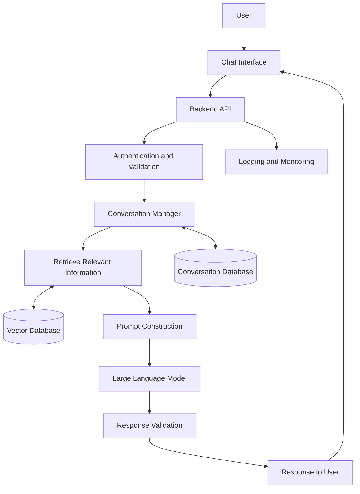

# Task 2 – Key Architectural Components of an LLM-Based Chatbot

## 1. Introduction

An LLM-based chatbot is an application that uses a Large Language Model (LLM) to understand user messages and generate responses in natural language. It can be used for customer support, answering questions, summarizing documents, or assisting users with specific tasks.

A basic chatbot can send a user's question directly to an LLM and return the response. However, a useful chatbot needs other components to manage conversations, provide relevant information, protect user data, and handle errors.

For example, if I were building a chatbot that answers questions about company policies, I would use a Retrieval-Augmented Generation (RAG) approach. This would allow the chatbot to retrieve information from company documents before generating an answer.

## 2. High-Level Architecture

The following diagram shows the main components of a knowledge-based LLM chatbot.

The frontend handles user interaction, while the backend coordinates the processing. The retrieval component supplies useful information when necessary, and the LLM uses that information to generate a response. The database and monitoring components support conversation management and application reliability.

The vector database is optional for a simple chatbot, but it becomes useful when the chatbot needs to answer questions using a large collection of documents.

## 3. Main Architectural Components

### 3.1 User Interface

The user interface is where a person interacts with the chatbot. It could be a web application, mobile application, or messaging interface.

Its main responsibilities include accepting questions, displaying responses, showing loading indicators, and allowing users to continue previous conversations.

For example, I could build the interface using React and send messages to a backend API.

### 3.2 Backend API

The backend receives messages from the frontend and coordinates the chatbot's workflow. It communicates with the LLM provider, retrieves relevant information, and sends the final response back to the user.

The backend can be developed using frameworks such as FastAPI or Spring Boot. It should also validate requests, handle exceptions, and keep API credentials out of frontend code.

### 3.3 Authentication and Security

If the chatbot contains private or company-specific information, authentication is important. The application should verify the user's identity and check their permissions before accessing protected data.

API keys and other secrets should be stored securely on the server. The system should also apply appropriate request limits and avoid exposing sensitive information in logs.

### 3.4 Conversation Management

An LLM does not automatically remember every previous interaction in a new request. To maintain a conversation, the application can store previous messages and include relevant parts in subsequent prompts.

For example, if a user asks, "What is RAG?" and then asks, "What are its advantages?", the chatbot can use the previous message to understand what "its" refers to.

For longer conversations, the application can limit the amount of history sent to the model or summarize older messages. This helps control token usage, response time, and cost.

### 3.5 Retrieval-Augmented Generation (RAG)

RAG is useful when the chatbot needs information that may not be available in the language model's training data, such as company policies, internal documentation, or recently updated product information.

The document preparation process generally involves:

1. Collecting documents from approved sources.
2. Extracting their text and dividing it into smaller chunks.
3. Generating embeddings for those chunks.
4. Storing the embeddings, document references, and metadata in a vector database.

When a user asks a question, the system converts the question into an embedding and searches for relevant chunks. The retrieved information is passed to the LLM along with the user's question.

This helps the model produce answers based on the available documents. However, RAG does not guarantee that every answer will be correct, so the retrieval quality and final responses still need to be tested.

### 3.6 Vector Database

A vector database stores embeddings and allows the application to search for information based on similarity in meaning rather than exact keyword matches.

For example, a question such as "How can I request time off?" might retrieve a document titled "Employee Leave Policy", even if the wording is different.

The retrieved text can then be provided to the LLM as additional context. Depending on the system, the vector database may also support metadata filtering to narrow results by document category or user permissions.

### 3.7 Large Language Model (LLM)

The LLM is responsible for understanding the prompt and generating the response. The application can use a hosted model through an API or deploy a model on its own infrastructure.

The prompt usually includes system instructions, the current question, relevant conversation history, and any retrieved documents.

The model should be instructed to use the provided evidence when answering factual questions and acknowledge when the information is insufficient. The choice of model depends on response quality, latency, cost, privacy, and the complexity of the task.

### 3.8 Response Processing

After the LLM generates a response, the backend can check the output format, apply application-specific rules, and attach references to the documents used.

If the model or an external service fails, the application should return a useful error message rather than crashing or displaying a confusing response.

For a document-based chatbot, I would also like to show users which sources were used to produce an answer.

### 3.9 Data Storage and Monitoring

A chatbot may use a relational database to store user accounts, conversation records, and other structured information. A vector database can separately support semantic retrieval, although both kinds of data can also be stored using a database system that supports vector search.

Monitoring helps identify problems such as slow responses, failed requests, excessive model usage, and poor retrieval quality. User feedback and a small set of test questions can also help evaluate whether the chatbot is answering correctly.

## 4. How I Would Approach Building the Chatbot

I would start with a simple working version and add complexity only when needed.

**Step 1: Define the use case.** I would decide what the chatbot should answer, who will use it, and whether it needs private or external documents.

**Step 2: Build the basic application.** I would create a chat interface, a backend endpoint, and an integration with an LLM API.

**Step 3: Add conversation history.** I would store previous messages and include relevant context so the chatbot can handle follow-up questions.

**Step 4: Add RAG if required.** For a knowledge-based chatbot, I would prepare documents, generate embeddings, store them in a vector database, and retrieve relevant passages for each question.

**Step 5: Add security and error handling.** I would validate requests, secure credentials, enforce access permissions, and handle timeouts and API failures.

**Step 6: Test the complete system.** I would prepare example questions with expected answers and check retrieval relevance, response accuracy, latency, and cost. I would also test questions for which the knowledge base contains no suitable answer.

## 5. Conclusion

An LLM-based chatbot is more than a language model connected to a user interface. Its backend, conversation management, retrieval system, storage, security, and monitoring all contribute to how well it works.

For a simple chatbot, an interface, backend API, and LLM may be enough. For a chatbot that answers questions from private documents, I would add RAG and a vector database.

My approach would be to begin with the core functionality, test it using realistic questions, and gradually improve its reliability, security, and response quality based on the results.

## References

1. Lewis, P. et al. (2020). *Retrieval-Augmented Generation for Knowledge-Intensive NLP Tasks.* https://arxiv.org/abs/2005.11401
2. LangChain Documentation – Retrieval. https://docs.langchain.com/oss/python/langchain/retrieval