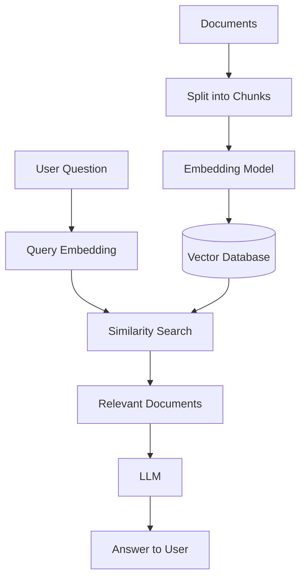

# Task 3 – Vector Databases and Their Selection

## 1. What Is a Vector Database?

A vector database is a database designed to store and search numerical representations of data called **vectors**. These vectors are usually generated by machine-learning models called embedding models.

For example, consider these two questions:

- "How can I apply for leave?"
- "What is the procedure for requesting time off?"

The wording is different, but both questions have a similar meaning. An embedding model converts each question into a numerical vector that captures information about its meaning. A vector database can compare these vectors and find related information.

This is useful when a system needs to search by meaning rather than only by exact keywords.

Traditional databases such as PostgreSQL are useful for structured queries, such as finding an employee by ID or retrieving tasks belonging to a project. A vector database is useful for finding content that is semantically similar to a question.

Some vector databases are specialized systems, while others, such as PostgreSQL with the pgvector extension, add vector-search capabilities to an existing relational database.

## 2. How Does Vector Search Work?

The basic process is:

1. **Create embeddings:** Convert documents, paragraphs, or other content into numerical vectors using an embedding model.
2. **Store the data:** Save the vectors along with the original text or a reference to it and useful metadata.
3. **Convert the query:** When a user asks a question, generate an embedding for that question using the same compatible embedding model.
4. **Search for similar vectors:** Compare the query vector against stored vectors and retrieve the nearest matches.
5. **Use the results:** Return the relevant content or pass it to an LLM to generate an answer.

The similarity between vectors can be calculated using methods such as cosine distance, dot product, or Euclidean distance. The correct method depends on the embedding model and how its vectors are intended to be compared.

For large datasets, vector databases can use indexes such as HNSW or IVFFlat to speed up approximate nearest-neighbor search. Approximate search can improve performance, but it may not always return exactly the same results as an exhaustive search.

### Example workflow



This is a common approach used in Retrieval-Augmented Generation (RAG). Instead of relying only on information learned during training, the LLM can use relevant information retrieved from an external knowledge base.

## 3. Important Features of Vector Databases

The main features I would consider when selecting a vector database are:

| Feature | Why it matters |
|---|---|
| Vector similarity search | Finds content related to a query by meaning. |
| Indexing | Helps improve retrieval speed as the dataset grows. |
| Metadata filtering | Restricts results by fields such as document category, department, or tenant. |
| Updates and deletion | Allows the index to stay synchronized when source documents change. |
| Scalability | Determines how the system handles increasing data and search traffic. |
| Integration | Affects how easily the database fits into the existing application. |
| Security | Important when different users must have access to different documents. |

A vector database does not replace an LLM. It retrieves potentially relevant information, while the LLM uses that information to generate a response. The quality of the final answer still depends on the source documents, embeddings, retrieval process, and model.

## 4. Hypothetical Problem: A Knowledge Assistant for FlowSync

Suppose I am building a chatbot for FlowSync, an employee productivity platform. Employees may want to ask questions about leave policies, attendance procedures, project workflows, and internal documentation.

For example:

- How do I apply for leave?
- How can I create a new sprint?
- Where can I find the attendance policy?
- What should I do if I cannot access a project?

The application could maintain a collection of approved company documents and use a RAG pipeline to answer these questions.

I would assume that the application already uses PostgreSQL for structured data, and that the knowledge base is initially moderate in size. These are assumptions for the hypothetical problem, not measured facts about an actual deployment.

## 5. My Choice: PostgreSQL with pgvector

I would choose **PostgreSQL with the pgvector extension** for this initial implementation.

pgvector adds vector storage and similarity search to PostgreSQL. This would allow the application to maintain document metadata and embeddings in the same database platform as its other structured data.

### Why I would choose it

**1. Integration with the existing database**

Since the hypothetical application already uses PostgreSQL, adding pgvector would avoid introducing a separate database service just for vector search.

**2. Simpler development and maintenance**

The application team could manage relational records, document metadata, and vector search using PostgreSQL. This makes the initial architecture easier to operate.

**3. Support for similarity search**

pgvector supports exact nearest-neighbor search and approximate indexes such as HNSW and IVFFlat. These options allow the application to tune retrieval performance as requirements change.

**4. Combining vector search with SQL**

The application can use normal SQL conditions alongside similarity search. For example, it could search only within approved documents belonging to a particular department.

**5. A practical starting point**

I would begin with a simple implementation, measure retrieval quality and latency, and optimize the indexes only when the results show a need for it.

### Example table design

The following is a simplified example of how document chunks could be stored. The embedding dimension of `1536` is illustrative and must match the selected embedding model.

```sql
CREATE EXTENSION IF NOT EXISTS vector;

CREATE TABLE document_chunks (
    id BIGSERIAL PRIMARY KEY,
    document_id TEXT NOT NULL,
    content TEXT NOT NULL,
    department TEXT,
    embedding VECTOR(1536)
);
```

Each row represents a document chunk. The application would generate the embedding and save it with the text and associated metadata.

For a larger collection, I could add an HNSW index for cosine-distance search:

```sql
CREATE INDEX document_chunks_embedding_idx
ON document_chunks
USING hnsw (embedding vector_cosine_ops);
```

A simplified query to retrieve the five closest chunks would look like this:

```sql
SELECT
    document_id,
    content,
    embedding <=> '[...]'::vector AS distance
FROM document_chunks
ORDER BY embedding <=> '[...]'::vector
LIMIT 5;
```

Here, `[...]` is a placeholder for the actual query embedding generated by the application. The lower cosine distance indicates a closer match. The example is intended to illustrate the query structure, not to be run with the placeholder unchanged.

The retrieved chunks could then be included in the prompt sent to the LLM.

## 6. Limitations and Other Options

pgvector would be my starting choice, but it is not necessarily the best choice for every application.

For example, **Qdrant** is a specialized vector-search system that supports filtering using metadata stored alongside vectors. It could be worth considering if vector retrieval becomes a major part of the application or if its filtering and search requirements are better served by a dedicated system.

For the hypothetical FlowSync assistant, I would compare alternatives using the same collection of documents and test questions rather than deciding based on popularity alone.

Another important point is data security. If employees have access to different documents, the backend must enforce those permissions during retrieval. The chatbot should never be allowed to access confidential documents simply because their embeddings are similar to the user's question.

Approximate indexes also need testing. They can trade some retrieval accuracy for speed, and filtering can affect the number and quality of results returned. I would check these behaviours before using the system with real company information.

## 7. How I Would Evaluate the Choice

Before deploying the chatbot, I would prepare a small test dataset containing common employee questions and the documents that should answer them.

I would evaluate the database and retrieval pipeline using the following criteria:

- **Retrieval quality:** Are the correct documents appearing among the top results?
- **Answer quality:** Does the chatbot give a relevant answer supported by the retrieved information?
- **Latency:** How long does retrieval take?
- **Cost and resources:** How much storage and compute does the solution require?
- **Security:** Can one employee retrieve documents they are not authorized to access?
- **Maintenance:** How easily can the system handle new, changed, or deleted documents?

If pgvector meets the requirements, I would continue using it rather than adding another service without a clear benefit. If measured workload or operational needs change, I would benchmark it against a specialized vector database such as Qdrant.

## Conclusion

Vector databases are useful when an application needs to find information based on semantic similarity instead of relying only on exact keyword searches. They are especially helpful in RAG-based chatbots, document search, and recommendation systems.

For the hypothetical FlowSync knowledge assistant, I would start with PostgreSQL and pgvector because the application already uses PostgreSQL and the integration would keep the initial architecture simple. I would then evaluate retrieval quality, latency, security, and resource usage before deciding whether a separate vector database is necessary.

## References

1. **pgvector documentation:** https://github.com/pgvector/pgvector
2. **Qdrant documentation – Filtering:** https://qdrant.tech/documentation/search/filtering/
3. Lewis, P. et al. (2020). *Retrieval-Augmented Generation for Knowledge-Intensive NLP Tasks.* https://arxiv.org/abs/2005.11401